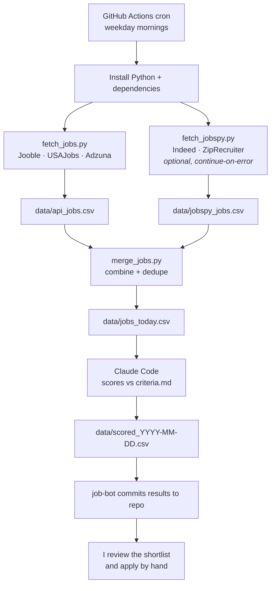
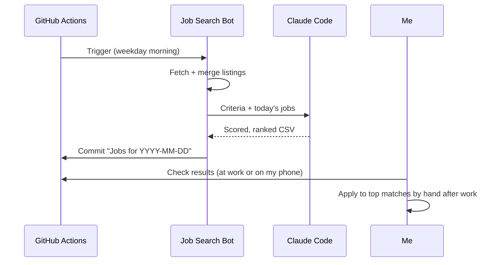

# Job Search Bot

An automated job search pipeline. Every weekday morning it pulls fresh listings from several job sources, has Claude score each one against my criteria, and saves a ranked shortlist to this repo. It never applies for me I review the results and apply by hand.

---

## Table of Contents

- [Why I Built This](#why-i-built-this)
- [Features](#features)
- [How It Works](#how-it-works)
- [Project Structure](#project-structure)
- [Tech Stack](#tech-stack)
- [Setup](#setup)
- [Running the Bot](#running-the-bot)
- [Reading the Results](#reading-the-results)
- [Customizing](#customizing)
- [Security](#security)
- [Troubleshooting](#troubleshooting)
- [Roadmap](#roadmap)

---

## Why I Built This

Job searching means checking the same sites every day and reading dozens of listings that turn out to be senior roles, part-time or the wrong location. I wanted a tool that:

- searches for me on a schedule, even while I'm at work with my laptop closed,
- filters out the noise so I only read the jobs worth my time,
- keeps me in control of every application.

---

## Features

| Feature | Description |
|---|---|
| **Scheduled runs** | Runs automatically every weekday morning on GitHub Actions, with no computer left on. |
| **Multi-source search** | Pulls from **Jooble**, **USAJobs** and **Adzuna** APIs, plus **Indeed / ZipRecruiter** through JobSpy. |
| **Fault-tolerant sources** | Each source fails independently. A missing key or a blocked scraper is skipped without breaking the run. |
| **Deduplication** | Merges every source into one list and removes duplicate postings (same title + company). |
| **AI scoring** | Claude Code scores each job **1–10** against `criteria.md` and tags it **apply** or **skip** with a one-line reason. |
| **Ranked daily CSV** | Results are sorted best-first and committed to the repo as `scored_YYYY-MM-DD.csv`, keeping a full history. |
| **Check from anywhere** | GitHub renders CSVs as tables, so the shortlist can be read from a phone or any browser. |
| **Secrets stay secret** | All API keys and tokens live in encrypted GitHub Secrets, never in the code. |
| **Human in the loop** | The bot never submits applications. Final decisions are always mine. |
| **Job Finder web app** | A separate Flask app for searching by hand and saving jobs to a Google Sheet. |

---

## How It Works

### Daily pipeline



### My daily routine



---

## Project Structure

```
job-search/
├── .github/
│   └── workflows/
│       └── job-search.yml      # Schedule + pipeline steps
├── job-finder/
│   ├── scheduler/              # Automated pipeline
│   │   ├── criteria.md         # What counts as a good job (read by Claude)
│   │   ├── fetch_jobs.py       # Jooble, USAJobs, Adzuna APIs
│   │   ├── fetch_jobspy.py     # Indeed / ZipRecruiter via JobSpy
│   │   ├── merge_jobs.py       # Combine + dedupe
│   │   ├── requirements.txt
│   │   └── data/               # Generated CSVs (created on first run)
│   ├── templates/              # Flask app templates
│   ├── server.py               # Job Finder web app
│   ├── settings.py
│   ├── sheet.py                # Google Sheets integration
│   ├── sources.py              # Job source connectors
│   └── requirements.txt
├── .gitignore
├── GUIDE.md
└── README.md
```

---

## Tech Stack

- **Automation:** GitHub Actions (cron + manual dispatch)
- **Language:** Python 3.11 (`requests`, `pandas`)
- **Job sources:** Jooble API, USAJobs API, Adzuna API, [JobSpy](https://github.com/speedyapply/JobSpy)
- **AI scoring:** Claude Code (headless mode)
- **Web app:** Flask + Google Sheets

---

## Setup

### 1. Clone the repo

```bash
git clone https://github.com/katkay1997/job-search.git
cd job-search-bot
```

### 2. Get API keys

| Source | Where to get it | Required? |
|---|---|---|
| Jooble | [jooble.org/api/about](https://jooble.org/api/about) | Yes |
| USAJobs | [developer.usajobs.gov](https://developer.usajobs.gov/) | Yes |
| Adzuna | [developer.adzuna.com](https://developer.adzuna.com/) | Optional |
| Claude Code | Run `claude setup-token` in a terminal | Yes |

### 3. Add GitHub Secrets

Go to **Settings → Secrets and variables → Actions → New repository secret** and add:

| Secret name | Value |
|---|---|
| `CLAUDE_CODE_OAUTH_TOKEN` | Token from `claude setup-token` |
| `JOOBLE_KEY` | Jooble API key |
| `USAJOBS_KEY` | USAJobs API key |
| `USAJOBS_EMAIL` | Email used to register for USAJobs |
| `ADZUNA_APP_ID` | *(optional)* Adzuna app ID |
| `ADZUNA_APP_KEY` | *(optional)* Adzuna app key |

> Sources without keys are skipped automatically, so you can start with just one.

### 4. (Optional) Run locally

```bash
cd job-finder/scheduler
pip install -r requirements.txt
python fetch_jobs.py
python fetch_jobspy.py
python merge_jobs.py
```

Set your keys as environment variables first. Never hard-code them.

---

## Running the Bot

**Automatically:** the workflow runs every weekday on the schedule in `job-search.yml`:

```yaml
schedule:
  - cron: "7 15 * * 1-5"   # 10:07 a.m. Eastern (standard time), Mon–Fri
```

> GitHub cron uses **UTC**. Use `14` during daylight saving time and `15` during standard time to stay at 10 a.m. Eastern. Scheduling a few minutes past the hour helps avoid GitHub's top-of-the-hour delays.

**Manually:** go to **Actions → Daily Job Search → Run workflow**.

A typical run takes about **2–4 minutes**.

---

## Reading the Results

After each run, open `job-finder/scheduler/data/`:

| File | What it is |
|---|---|
| `scored_YYYY-MM-DD.csv` | **The daily shortlist**, ranked best-first |
| `jobs_today.csv` | Merged, deduped raw listings (overwritten daily) |
| `api_jobs.csv` | Raw API results (overwritten daily) |
| `jobspy_jobs.csv` | Raw JobSpy results (overwritten daily) |

Scored file columns:

| score | decision | reason | title | company | location | url |
|---|---|---|---|---|---|---|
| 9 | apply | Entry-level C# role at a public-sector org in NYC | Junior .NET Developer | Example Agency | New York, NY | … |
| 3 | skip | Requires 5+ years of experience | Senior Software Engineer | Example Co | Remote | … |

---

## Customizing

- **Change what counts as a good job:** edit `criteria.md`. Claude reads it on every run, so no code changes are needed.
- **Change search terms:** edit `SEARCHES` (and `USAJOBS_SEARCHES`) at the top of `fetch_jobs.py`.
- **Change location:** edit `LOCATION` in `fetch_jobs.py` and `fetch_jobspy.py`.
- **Change JobSpy volume:** adjust `results_wanted` and `search_term` in `fetch_jobspy.py`.
- **Change the schedule:** edit the `cron` line in `.github/workflows/job-search.yml`.

---

## Security

- The repo is **private**, since daily results are committed here.
- All credentials are stored as **encrypted GitHub Secrets** and masked in logs.
- `.gitignore` keeps local secret files (`.env`, `job-finder-secrets/`) out of version control.
- The bot only **reads** job listings. It never logs into job sites or submits applications.
- If the repo is ever made public or shared, rotate all API keys first.

---

## Troubleshooting

| Symptom | Likely cause | Fix |
|---|---|---|
| Red X on a run | A step failed | Open the failed step in Actions and read the error |
| Green run but no `scored_` CSV | Claude didn't produce output | Check the **Score with Claude** step log |
| Very few jobs | API returned nothing | Look for `Jooble error` / `USAJobs error` in **Fetch from APIs** |
| No USAJobs results | Federal titles differ | Use terms like "IT Specialist" in `USAJOBS_SEARCHES` |
| JobSpy step failed | Site blocked GitHub's servers | Expected sometimes; the run continues without it |
| Scheduled run is late or missing | GitHub load at the top of the hour | Use an off-the-hour minute; trigger manually if needed |
| `git push` rejected locally | Files were edited on GitHub | Run `git pull --no-rebase` and then `git push` |

---

## Roadmap

- [ ] Send a daily email or notification with the top 5 matches
- [ ] Sync scored results to the Job Finder Google Sheet
- [ ] Skip jobs already seen on previous days
- [ ] Cap results per source so no single source dominates
- [ ] Track application status (applied / interviewing / rejected)

---

## Author

**Kat**: CS graduate (CUNY York College) building practical tools.
GitHub: [@katkay1997](https://github.com/katkay1997)
